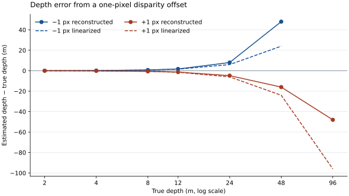

# Stereo Depth Lab

[](https://github.com/yhu2190-ctrl/stereo-depth-lab/actions/workflows/build.yml)

A dependency-free C++17 tool for reconstructing 3D points from matched pixels in a rectified stereo pair. It reports the reconstructed point, horizontal disparity, and vertical mismatch.

一个用 C++17 写的双目三角化工具。给定已校正的左右图像中同一个点的像素坐标，以及相机内参和基线距离，计算该点在左相机坐标系下的三维位置。

## Build and run

Install a C++17 compiler and CMake 3.20 or newer. On Windows, you can run these commands from a Visual Studio Developer PowerShell with CMake available.

```sh
cmake -S . -B build -DCMAKE_BUILD_TYPE=Release
cmake --build build --config Release
ctest --test-dir build -C Release --output-on-failure
```

```powershell
# Windows with a Visual Studio generator
.\build\Release\stereo_point.exe 800 800 320 240 0.12 400 260 376 260
```

```sh
# Linux or macOS with a single-config generator
./build/stereo_point 800 800 320 240 0.12 400 260 376 260
```

```text
x_m=0.4 y_m=0.1 z_m=4
disparity_px=24 vertical_mismatch_px=0
```

参数依次为 `fx fy cx cy baseline_m u_left v_left u_right v_right`。焦距和像素坐标以像素为单位，基线和三维结果以米为单位。左相机的 X 轴向右、Y 轴向下、Z 轴向前。

## How it works · 公式怎么来的

两台校正后的相机使用相同内参，右相机相对左相机沿 X 轴向右平移了距离 B。空间点在右相机坐标系下的 X 坐标因此为 X − B。针孔投影给出：

```text
u_left  = fx × X / Z + cx
u_right = fx × (X − B) / Z + cx
d       = u_left − u_right = fx × B / Z
```

所以深度 Z = fx × B / d。示例里 B = 0.12 m，d = 24 px，手算得到 Z = 800 × 0.12 / 24 = 4 m。再用左图的 u 恢复 X，用两张图的 v 的平均值恢复 Y。理想校正且匹配准确时，两张图的 v 相同，工具也会单独报告它们的差值绝对值。

现有测试用已知三维点生成左右像素，再检查三角化能否恢复原坐标。工具会拒绝非正视差。很小的正视差仍可计算，但深度对像素误差更敏感。

## Batch reconstruction · 批量重建

用 `stereo_batch` 批量读取已匹配的像素坐标。输入是 UTF-8 CSV，首行为 `u_left,v_left,u_right,v_right`，后面每行四个逗号分隔的数字，无引号。从仓库根目录运行：

```powershell
# Windows with a Visual Studio generator
.\build\Release\stereo_batch.exe 800 800 320 240 0.12 examples\matches.csv
```

```sh
# Linux or macOS with a single-config generator
./build/stereo_batch 800 800 320 240 0.12 examples/matches.csv
```

```csv
row,x_m,y_m,z_m,disparity_px,vertical_mismatch_px,status
1,0.4,0.1,4,24,0,ok
2,,,,,,invalid_disparity
3,,,,,,malformed_row
4,-0.1,-0.05,2,48,0,ok
5,0.4,0.105,4,24,2,ok
```

输出中的 `row` 从第一条数据开始编号。样例里第一和第四条分别对应真值 `(0.4, 0.1, 4)` 和 `(-0.1, -0.05, 2)`。第二条视差为零，第三条有非法数字。程序会给每行记录状态，继续处理后续行。若相机参数、表头或文件读写失败，进程返回非零状态码。把输出重定向到文件即可保存为 CSV。

可在文件名后加 `--max-vertical-mismatch 1`，拒绝左右纵坐标相差超过 1 px 的匹配。样例第五条相差 2 px，启用该阈值后会标记为 `vertical_mismatch`，保留视差和纵向差值，三维坐标留空。阈值等于差值时保留该行。默认接受任意有限的纵向差值，并把差值写入输出。

### Export a point cloud · 导出点云

加 `--format ply` 可把有效的三维点保存为 ASCII PLY。示例同时启用 1 px 纵向差值阈值：

```powershell
# Windows with a Visual Studio generator
.\build\Release\stereo_batch.exe 800 800 320 240 0.12 examples\matches.csv --max-vertical-mismatch 1 --format ply | Set-Content -Encoding ascii points.ply
```

```sh
# Linux or macOS with a single-config generator
./build/stereo_batch 800 800 320 240 0.12 examples/matches.csv --max-vertical-mismatch 1 --format ply > points.ply
```

打开 `points.ply`，文件头应有 `element vertex 2`，末尾两行应为 `0.4 0.1 4` 和 `-0.1 -0.05 2`。坐标以米为单位，按左相机的 X 向右、Y 向下、Z 向前导出。终端会报告导出的点数，可用默认的 CSV 输出查看逐行筛选原因。若无符合条件的点，仍会输出文件头，顶点数为零。PLY 模式会暂存有效点以预先写入顶点数，默认 CSV 模式逐行输出。

### Synthetic scene · 合成点云演示

下载 [wireframe.ply](examples/wireframe.ply)，用支持 PLY 的点云查看器打开，旋转视角可以看到长方体的前后两面和连接它们的四条棱。PLY 只保存顶点，查看时用点显示。线框沿棱每隔 0.125 m 采样一次，共 84 个点，角点各计一次。左相机坐标中，X 从 −0.5 m 到 +0.5 m，Y 从 −0.375 m 到 +0.375 m，前后两面分别在 Z = 2 m 和 Z = 3 m。

从仓库根目录运行以下命令可复现。`stereo_scene` 用焦距 768 px、主点 (320, 240) px、基线 0.125 m 把真值投影成左右像素。`stereo_batch` 读取这些匹配，用相同参数重建点云。

```powershell
# Windows with a Visual Studio generator
.\build\Release\stereo_scene.exe | Set-Content -Encoding ascii build\scene-matches.csv
.\build\Release\stereo_batch.exe 768 768 320 240 0.125 build\scene-matches.csv --max-vertical-mismatch 0 --format ply | Set-Content -Encoding ascii build\scene.ply
```

```sh
# Linux or macOS with a single-config generator
./build/stereo_scene > build/scene-matches.csv
./build/stereo_batch 768 768 320 240 0.125 build/scene-matches.csv --max-vertical-mismatch 0 --format ply > build/scene.ply
```

终端应显示 `stereo_batch: exported 84 of 84 rows`。近端角点 `(-0.5, -0.375, 2)` 对应左图 `(128, 96)`、右图 `(80, 96)`，视差是 48 px，代入公式得到 `768 × 0.125 / 48 = 2 m`。测试核对这个角点和远端对角点的像素，并用 `wireframe.ply` 中的真值逐点核对输出。此演示使用未取整的理想投影和已知对应点，各条棱上的采样点都参与重建。

## Pixel noise experiment · 像素误差实验

```powershell
# Windows with a Visual Studio generator
.\build\Release\stereo_noise.exe | Set-Content -Encoding ascii stereo-noise.csv
```

```sh
# Linux or macOS with a single-config generator
./build/stereo_noise > stereo-noise.csv
```

固定焦距 800 px、基线 0.12 m，把已知深度的三维点投影到两台理想相机。给左右图的水平坐标分别加上 −1、0 或 +1 px，枚举全部 9 种组合。深度只取决于左右偏移之差，所以 CSV 按 5 种视差偏移汇总，`case_count` 是该行对应的组合数。若视差变为零或负数，该行记录 `invalid_disparity`，估计深度和误差留空。

| 真实深度 | 真实视差 | 视差偏小 1 px 时的估计深度 | 深度误差 |
| --- | --- | --- | --- |
| 4 m | 24 px | 4.174 m | +0.174 m |
| 12 m | 8 px | 13.714 m | +1.714 m |
| 24 m | 4 px | 32.000 m | +8.000 m |

在这个例子中，12 m 处和 4 m 处都少了 1 px 视差，前者的深度误差约是后者的 9.9 倍。用 `Z = fx × B / d` 在真实视差 `d` 处求导，可得到小扰动下的误差近似 `ΔZ ≈ −Z × Δd / d`。CSV 同时记录实际误差和这个近似值，方便比较视差偏移接近真实视差时，两者会差多远。

### Depth error plot · 深度误差图



图从上面生成的 `stereo-noise.csv` 读取视差偏差为 −1 px 和 +1 px 的记录。横轴是真实深度（米、以 2 为底的对数刻度），纵轴是估计深度减真值（米）。圆点是 CSV 中的重建误差，虚线是同一批数据的线性近似，连线用于对比趋势。只有观测视差大于零才有深度估计，所以 96 m 处的 −1 px 曲线没有数据点。

48 m 处真实视差为 2 px。少 1 px 时，估计深度是 96 m，误差为 +48 m，是线性近似 +24 m 的两倍。多 1 px 时，估计深度是 32 m，误差为 −16 m。同样大小的像素偏差会产生不同大小的深度误差。图展示理想相机上的确定性扰动，左右像素的不同偏移组合可以产生同一个视差偏差。实际图像还受标定、校正和匹配误差影响。

要重新生成 SVG，先用上面的命令生成 CSV，再用 Python 3.10 或更新版本运行下面两条命令。Matplotlib 只用于画图，C++ 构建和测试仍只需要 CMake 和 C++17 编译器。

```powershell
# Windows
py -3 -m pip install "matplotlib>=3.8"
py -3 experiments\plot_noise.py stereo-noise.csv build\stereo-noise.svg
```

```sh
# Linux or macOS
python3 -m pip install "matplotlib>=3.8"
python3 experiments/plot_noise.py stereo-noise.csv build/stereo-noise.svg
```

## Scope · 当前范围

`stereo_point` 和 `stereo_batch` 使用已匹配的像素坐标。相机标定、图像校正和特征匹配由上游完成。噪声实验使用已知真值的合成点，报告的是给定相机和像素扰动下的深度误差。

See [Hartley and Sturm, *Triangulation*](https://doi.org/10.1006/cviu.1997.0547) for triangulation with general camera poses.

MIT licensed. See [LICENSE](LICENSE).
